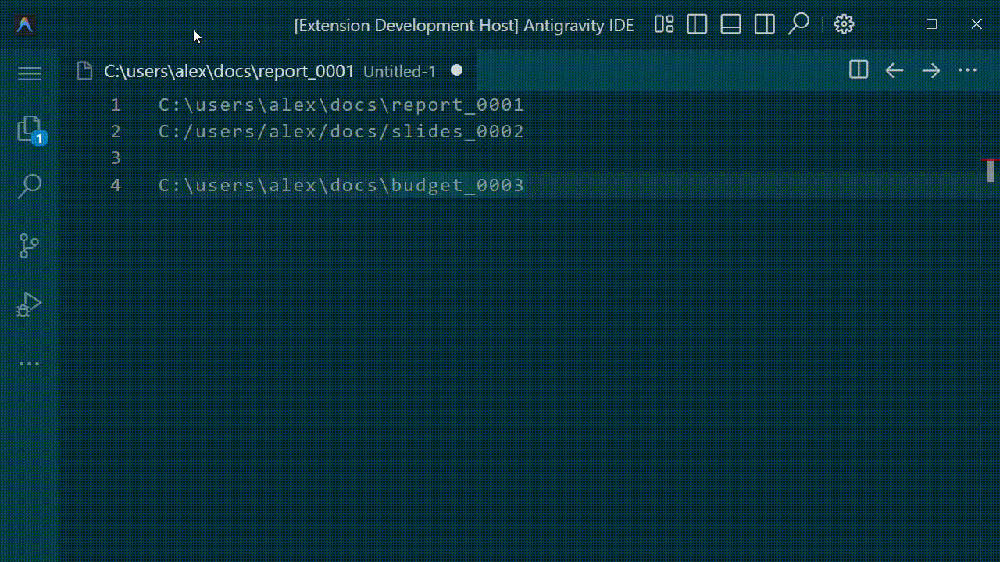
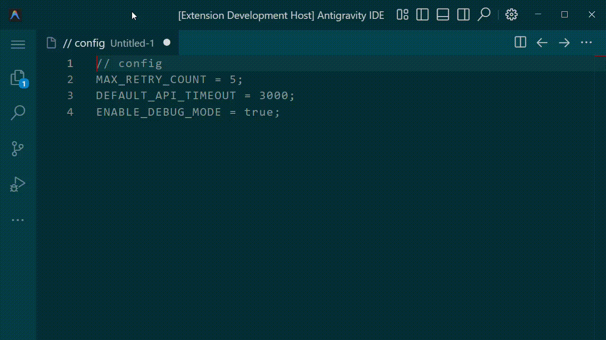
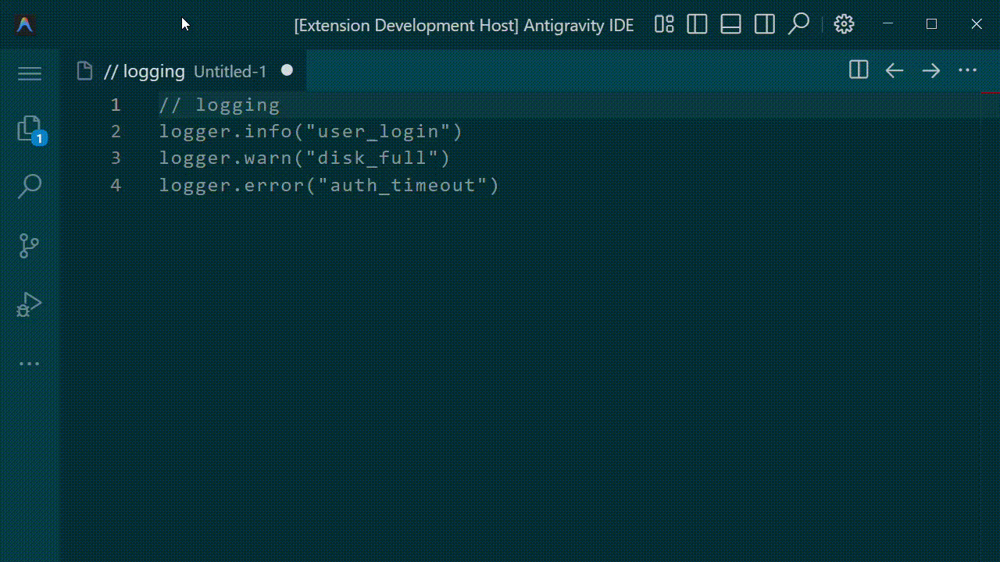
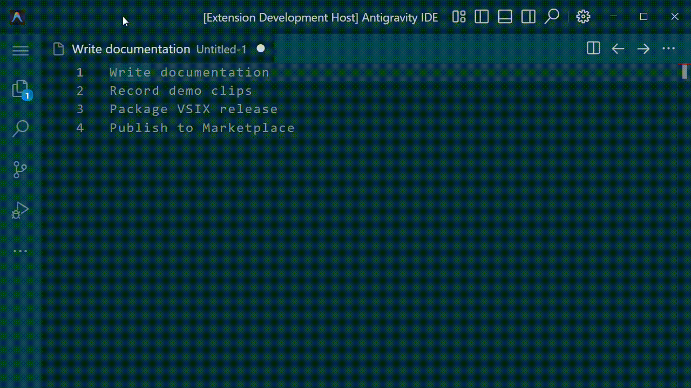

# RegExpresso ☕

<h4>Installation (VS Code / Antigravity)</h4>

1. Download the latest `.vsix` installer from the [Releases](../../releases) page.
2. Open **VS Code** or **Antigravity** and open the **Extensions** sidebar (`Ctrl+Shift+X` on Windows/Linux, `Cmd+Shift+X` on macOS).
3. Click the **`...`** menu in the top-right corner of the Extensions sidebar and select **Install from VSIX...**
4. Select the downloaded `.vsix` file to install.
   

**Natural Language to Regular Expressions, Multi-Caret Selection & Structural Replace for VS Code — 100% Offline, Instant, and Deterministic.**

RegExpresso turns plain English—or terse power-user shorthand—directly into valid VS Code regular expressions, complete with **live in-editor match highlighting**, **inline replacement previews**, **one-keystroke multi-caret selection**, and **Boost-style case transformations**.

No AI. No LLMs. No API keys, network calls, or latency. Everything compiles deterministically on every keystroke.

---

## Why RegExpresso?

### For Everyday Editing
Stop context-switching to a browser to look up negative lookbehinds, non-greedy quantifiers, or character class escaping rules. Just describe what you want in plain English:
- *"Delete all the blank lines"*
- *"Add a semicolon to the end of every line that doesn't have one"*
- *"Find all numbers that have a dollar sign directly in front of them"*
- *"Put quotation marks around every item in this column"*
- *"Wrap every URL link in an HTML anchor tag"*

### For Power Users & Multi-Caret Workflows
Even if you know regex by heart, typing `^(?<!;)(\s*)$` or managing capture groups in the native Find widget takes more keystrokes than necessary. RegExpresso gives you a command-line-fast text manipulation bar (`Alt+F` / `Cmd+Alt+F`) with terse shorthands and instant multi-cursor placement:
- `rep slashes with tabs` → replaces all `/` and `\` with `\t`
- `rm last 4 per` → deletes the last 4 characters on every line
- `sel words starting with use` → selects all matching words with individual multi-carets
- `cap first per` → capitalizes the first character of every line
- `trim lines` → strips leading and trailing horizontal whitespace across the file

---

## Quick Start

1. Open any text editor in VS Code and press **`Alt+F`** (`Cmd+Alt+F` on macOS), or run **`RegExpresso: Natural Language Find & Replace`** from the Command Palette (`Ctrl+Shift+P`).
2. Type what you want to find, select, delete, or replace.
   - As you type, RegExpresso highlights every match in the active editor and renders inline `→ preview` annotations showing the exact result of replacements or deletions.
3. Press **`Enter`** to execute the top action (automatically chosen based on your verb: **Replace All** for `replace`/`delete`/`add`/`wrap`, or **Select All Matches with Multi-Caret** for `find`/`select`), or use **`Up` / `Down`** to pick another execution mode.
4. The RegExpresso bar stays open and focused so you can chain multiple edits in seconds, and **remembers its active/inactive visibility and query text per editor tab** as you switch between files (via mouse click or `Ctrl+Tab`). Use **`Shift+Up` / `Shift+Down`** to cycle through your session query history, or press **`Esc`** to dismiss the bar for the current tab.

---

## Core Shortcuts & Controls

| Shortcut | Context | Action |
| :--- | :--- | :--- |
| `Alt+F` (`Cmd+Alt+F` on Mac) | Editor Focus | Open the RegExpresso bar |
| `Enter` | RegExpresso Bar | Execute the highlighted action and clear input for the next query |
| `Up` / `Down` | RegExpresso Bar | Choose between Replace, Multi-Caret, Extract, Copy, or Native Find actions |
| `Shift+Up` / `Shift+Down` | RegExpresso Bar | Cycle backward / forward through submitted query history |
| `Esc` | RegExpresso Bar | Dismiss the RegExpresso bar (preserving any active multi-caret selections) |

---

## Conversational vs. Shorthand Syntax

RegExpresso understands both descriptive sentences and concise shorthand commands:

| Goal | Conversational English | Power-User Shorthand | Compiled Find | Compiled Replace |
| :--- | :--- | :--- | :--- | :--- |
| Replace characters | `"Replace all slashes with tabs"` | `rep slashes with tabs` | `[/\\]` | `\t` |
| Ensure trailing char | `"Add a semicolon to the end of every line that doesn't have one"` | `ensure trailing ;` | `^([^\r\n]*?\S)(?<!;)([ \t]*)$` | `$1;$2` |
| Delete trailing chars | `"Delete the last 4 characters of every line"` | `rm last 4 per` | `.{4}$` | *(empty)* |
| Select inside quotes | `"Select text inside quotation marks"` | `sel quoted` / `sel quoted text` | `(?<=..."..."...)[^"\r\n]+(?=")\|...` | — |
| Select full strings | `"Select all quoted string literals"` | `sel strings` / `sel quote blocks` | `(?:"[^"\r\n]*"\|'[^'\r\n]*')` | — |
| Select delimited blocks | `"Select groups in brackets including brackets"` | `sel bracket blocks` / `sel brace blocks` | `\[[^\]\r\n]*\]` / `\{[^}\r\n]*\}` | — |
| Direct inline regex | `"Match \w+ and replace it with tabs"` | ``rep `\w+` with \t`` / `rep \w+ with tabs` | `\w+` | `\t` |
| Select uppercase runs | `"Select all capital letters"` | `sel caps` | `[A-Z]+` | — |
| Whole-word replace | `"Change whole words that say cat to dog"` | `rep word cat with dog` | `\bcat\b` | `dog` |
| Capitalize lines | `"Capitalize the very first letter of every line"` | `cap first per` | `^(.)` | `\U$1` |
| Trim whitespace / blanks | `"Remove leading and trailing spaces"` / `"Delete blank lines"` | `trim lines` / `trim blanks` | `^[ \t]+\|[ \t]+$` / `^\s*\r?\n` | *(empty)* |

### Common Intent Shorthands & Keywords

- **Find / Select**: `find`, `fnd`, `match`, `select`, `sel`, `get`, `grab` (or omit the verb entirely and just type the target, e.g. `emails`, `urls`, `strings`, `3 to 5 digits`)
- **Delete / Remove**: `delete`, `del`, `remove`, `rm`, `strip`, `clear`, `clr`
- **Trim**: `trim` (whitespace on both ends), `trim blanks` / `trim empties` (remove blank lines), `trim leading <X>` (e.g. `trim leading zeros`, `trim leading x`), `trim trailing <Y>` (e.g. `trim trailing ;`, `trim trailing commas`)
- **Ensure (Conditional Insert)**: `ensure trailing ;`, `ensure leading //`, `ensure every line ends with ;`, `ensure a space after commas` (or `add ... without one` / `that doesn't have one`)
- **Replace / Convert**: `replace`, `rep`, `change`, `chg`, `substitute`, `sub`, `convert`, `turn`, `make`
- **Insert / Add**: `add`, `insert`, `ins`, `append`, `app`, `prepend`, `prep`, `put`
- **Wrap / Enclose**: `wrap <X> in <Y>`, `put <Y> around <X>`, `surround <X> with <Y>`
- **Case Transform**: `capitalize`, `cap`, `uppercase`, `upper`, `lowercase`, `lower`, `make <X> camelCase / snake_case / Title Case`
- **Positional & Scope Keywords**: `leading <X>` (start of line), `trailing <Y>` (end of line), `per` / `per line` / `per-line` (`on every line`), `after <X>` / `preceded by <X>` (lookbehind), `before <X>` / `followed by <X>` (lookahead).
- **Inner Content (`quoted`, `bracketed`) vs. Delimited Blocks (`block` / `blocks`)**:
  - `select quoted` / `select quoted text` / `select inside quotes` / `select parenthesized text` / `select bracketed text` / `select braced text` selects only the characters *between* the delimiters (excluding the delimiters themselves).
  - `select quotation mark blocks` / `select quote blocks` (equivalent to `select strings` / `select quotations`), `select bracket blocks` (`\[[^\]\r\n]*\]`), `select brace blocks` (`\{[^}\r\n]*\}`), `select paren blocks` (`\([^)\r\n]*\)`), `select angle bracket blocks` (`<[^>\r\n]*>`), and `select backtick blocks` select the entire group *including* its surrounding delimiters.
- **Direct Regular Expressions & Escape Sequences**: Power users can type character classes, escape sequences, and regex patterns directly in queries (e.g. `select \w+`, `replace \w+ with tabs`, `replace numbers with \t\t`, `find [a-z0-9_]+`, `delete \d{2,4}`) or enclose complex inline regexes in backticks (`` `\w+` ``), tildes (`~\w+~`), or slashes (`/\w+/`). Tabs in replacement previews render visibly with the `⇥` glyph (e.g. `→ ⇥⇥`).

---

## Execution & Multi-Caret Modes

Every valid query gives you immediate access to 7 execution modes in the dropdown list:

1. **Execute Replace All** *(Default for `replace`, `delete`, `wrap`, `add`, `swap`, and case conversions)* — Applies single-step or multi-step regex replacements (including Boost `\U`, `\L`, `\u`, `\l`, `\E` case modifiers and named groups `$<name>`) across the document.
2. **Select All Matches with Multi-Caret** *(Default for `find` and `select`)* — Selects every matched substring simultaneously with individual cursors, ready for typing or piping into multi-caret tools like *Text Power Tools*.
3. **Place Carets at Start of Matches** — Places collapsed blinking cursors immediately before every match (or trigger directly by typing `"place carets before ..."`).
4. **Place Carets at End of Matches** — Places collapsed blinking cursors immediately after every match (or trigger directly by typing `"place carets after ..."`).
5. **Select Capture Group `$1` Only (Multi-Caret)** — Selects only the inner first capture group (`$1`) across all matches (ideal for selecting text inside quotes, parentheses, or tags without selecting the delimiters).
6. **Send to Native VS Code Find/Replace Widget** — Populates VS Code's built-in `Ctrl+F` / `Ctrl+H` widget with the synthesized regex and replacement string.
7. **Extract All Matches to New Buffer / Copy All Matches to Clipboard** — Dumps every matched substring (newline-separated) into a side-by-side untitled editor or directly into your system clipboard.

---

## Impossible Request Detection & One-Click Workarounds

Standard regular expressions (finite state automata) cannot maintain mutable counters across matches, evaluate arithmetic percentages, parse arbitrary recursive nesting, or sort lines globally.

When you ask for something that pure regex cannot do—such as *"Number each line sequentially"*, *"Sort all lines alphabetically"*, *"Remove scattered duplicate lines across the file"*, or *"Find arbitrarily nested curly braces"*—RegExpresso **explains why pure regex fails** and offers a **one-click native VS Code workaround** right in the dropdown list.

---

## Full Documentation

For a complete breakdown of supported natural language grammar, the full character class and symbol lexicon, lookarounds, quantifiers, case conversion pipelines, and advanced examples, see the **[Official RegExpresso Documentation (DOCS.md)](./DOCS.md)**.

